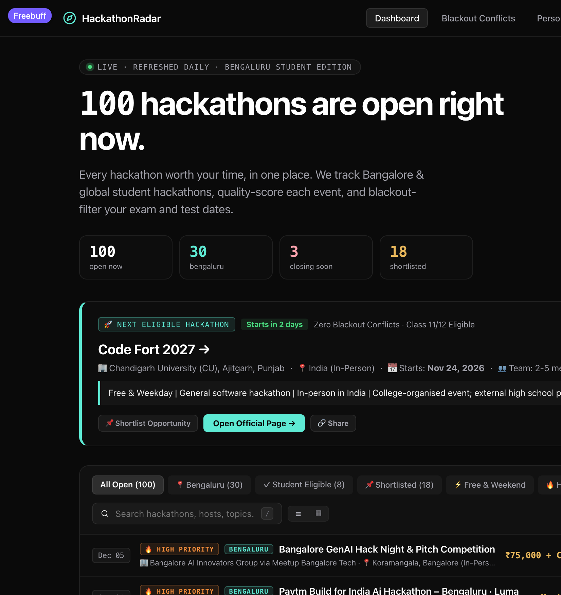
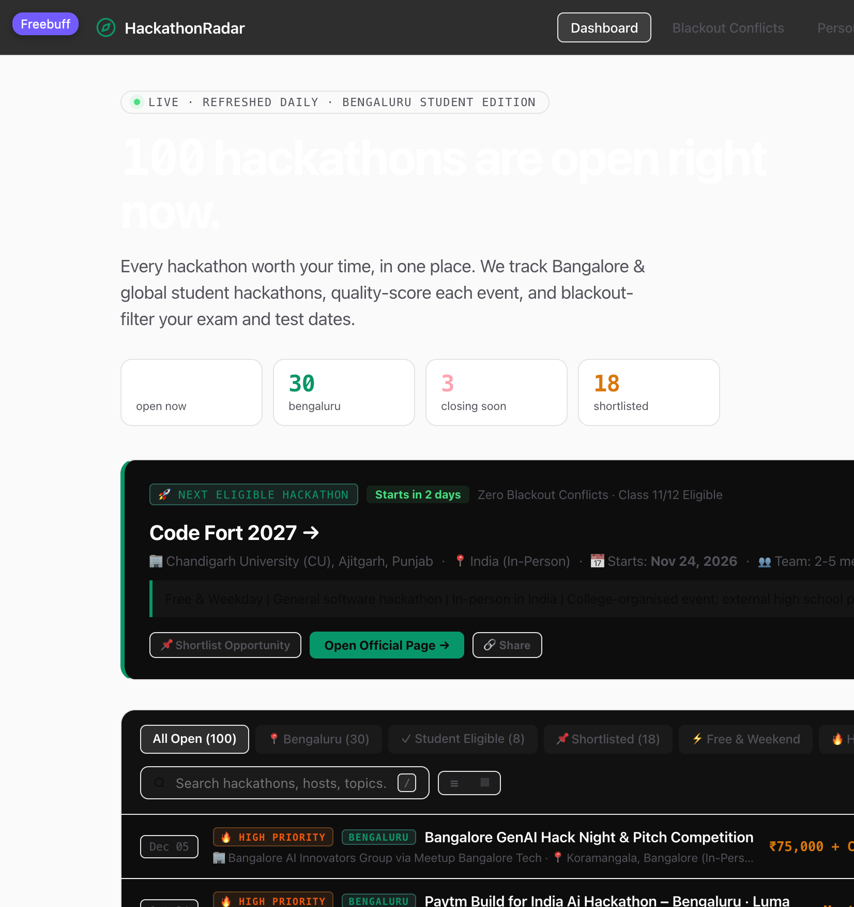
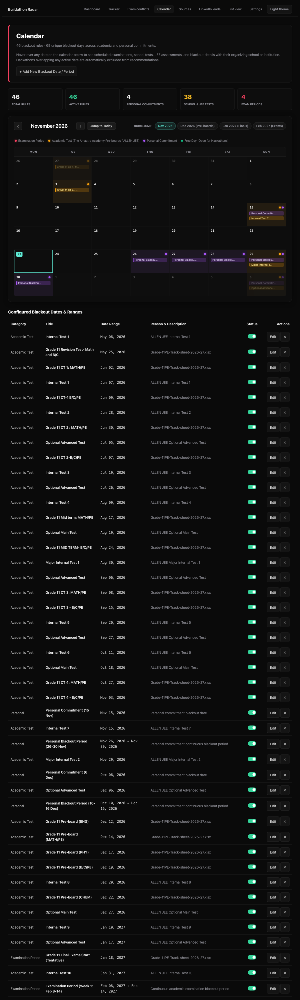
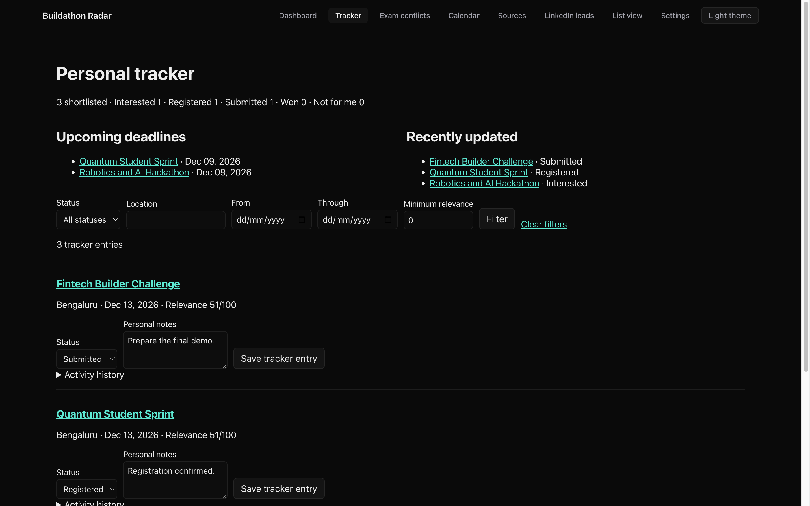
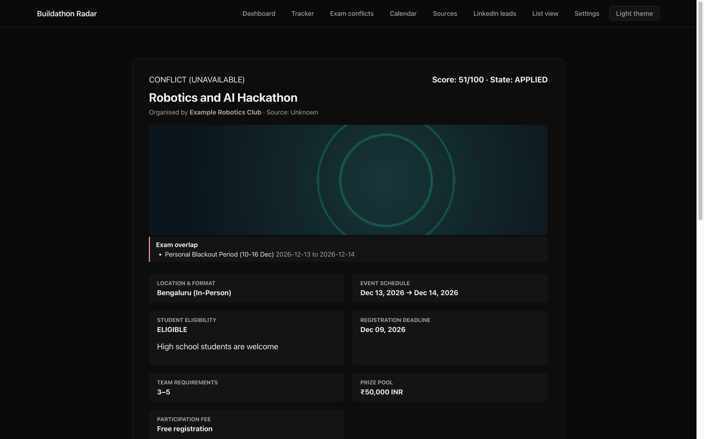
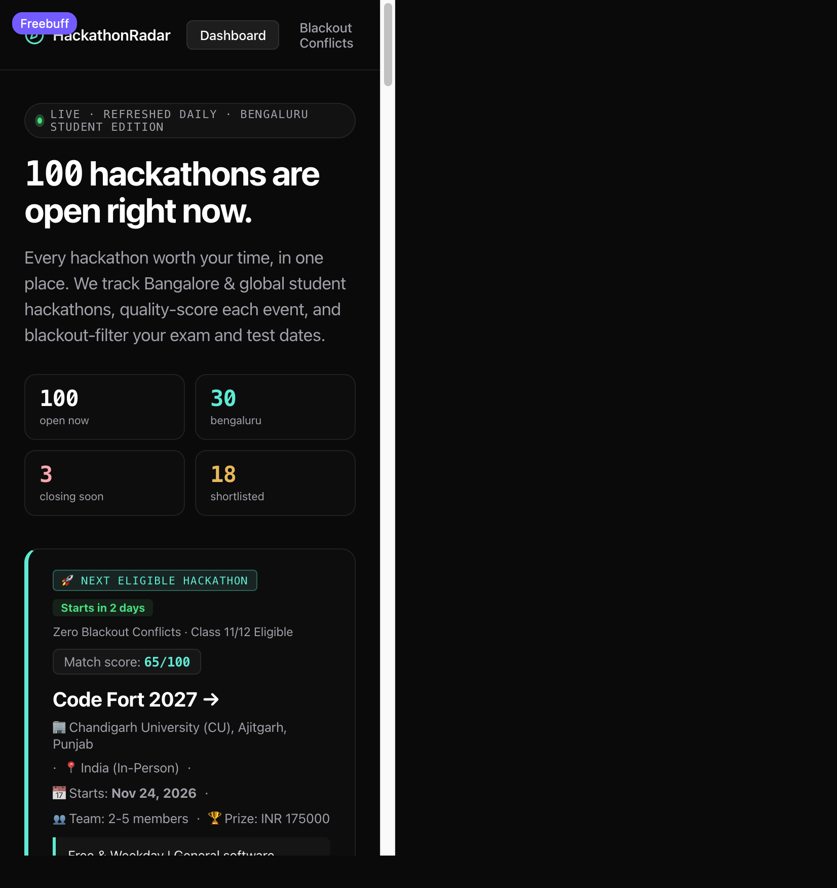
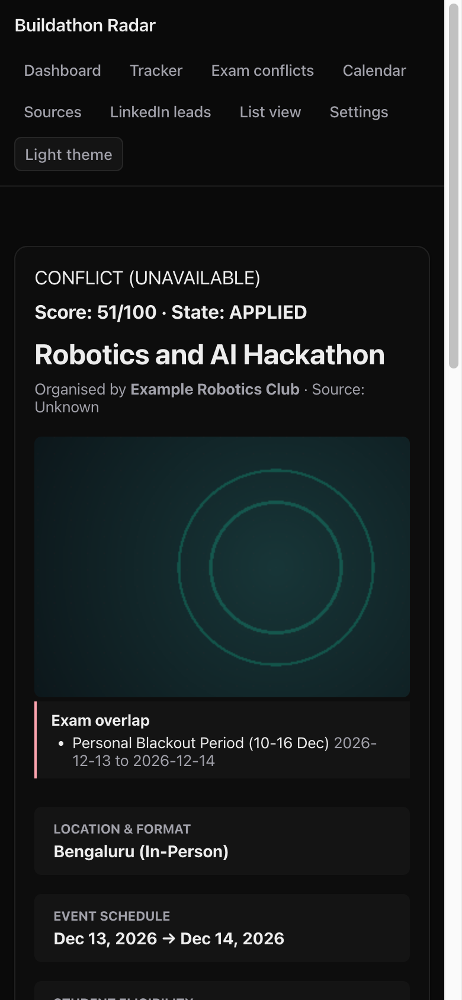
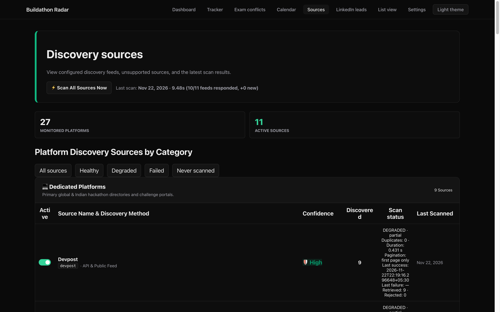
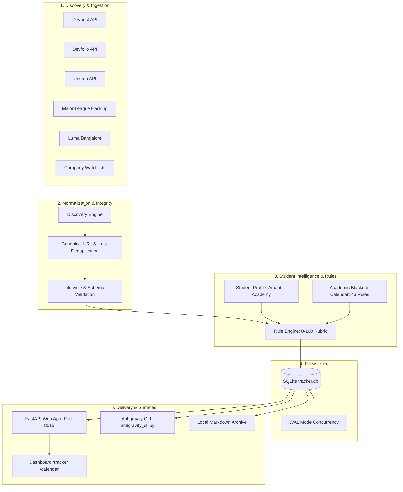

# Buildathon Radar

> **A student-first hackathon discovery and opportunity intelligence platform**

[](#testing-commands--verified-results)
[](#installation-instructions)
[](#technology-stack)
[-orange.svg)](#database--migrations)
[](#version)

---

## 1. Overview & Problem Solved

High-school students passionate about technology—specifically Class 11 and 12 students preparing for competitive academic milestones while building real-world software—face a broken competition landscape:

- **Aggregator Noise & False Claims:** Mainstream hackathon aggregators are flooded with corporate marketing webinars, generic contests, college-only festivals that ban minors, and expired listings.
- **Academic Blackouts vs. Competition Clashes:** Crucial school term examinations, pre-board exams, and national competitive exam preparation windows (such as CBSE, JEE, or school assessments) are routinely disrupted by poorly-timed hackathon commitments.
- **Paid Cloud & LLM Lock-In:** Typical "AI-powered" aggregators require expensive, metered third-party cloud LLM API keys (`ANTHROPIC_API_KEY`, OpenAI, etc.) just to parse and filter public event schedules.
- **Privacy Intrusion:** Web services often require invasive registrations, track user metrics, and upload student interest data to external marketing databases.

**Buildathon Radar** solves this end-to-end. Built specifically with the student profile of **The Amaatra Academy** (Bengaluru, Karnataka) in mind, it provides an automated, local-first discovery engine, transparent rule-based scoring (0–100 rubric), academic blackout protection (enforcing 46 school/exam rules across 69 unique blackout days), an interactive local web dashboard with full dark and light mode support, and an on-demand intelligence CLI for Antigravity.

---

## 2. Key Features

- **Automated Multi-Source Discovery:** Ingests and sanitizes competition feeds across public endpoints including Devpost, Devfolio, Unstop, MLH, Luma, and curated tech watchlists.
- **Rule-Based Scoring & Eligibility Filter (No LLM Required):** Transparent 0–100 relevance scoring evaluating theme alignment (AI/ML, Agents, Robotics, Systems, Web3), geography, team structure, and host prestige with zero external paid LLM API dependency.
- **Academic Blackout Protection:** Protects high-school study schedules by cross-referencing event dates against a 46-rule blackout calendar (CBSE exams, term tests, pre-boards, national entrances). Clashing events receive hard warnings or exclusion.
- **Interactive Monthly Calendar Grid:** Visual monthly calendar at `/calendar` featuring date-cell badges, exam schedules, and interactive hover tooltips that detail exams, organizing schools/boards, reasons, and active blackout conflict statuses.
- **Personal Student Tracker:** Local loopback tracker at `/tracker` (`/api/tracker`) with seamless note-taking, status transitions (`seen`, `tracked`, `applied`, `rejected`, `over`), and audit history without requiring loopback password barriers.
- **High-Fidelity Event Pages:** Dedicated permalink pages at `/h/{slug}` detailing comprehensive event metadata, host info, prize pools, eligibility justifications, and scoring factor breakdowns.
- **Source Health & Diagnostics:** Detailed inspection console at `/sources` auditing adapter reachability, response latency, item yields, and data lineage without fabricated metrics.
- **Antigravity On-Demand Intelligence Layer:** A native CLI (`antigravity_cli.py`) enabling quick terminal queries, deadline tracking, conflict analysis, and deep automated opportunity analysis.
- **Local-First & Resilient:** SQLite database with Write-Ahead Logging (WAL) concurrency, loopback HTTP binding (`127.0.0.1:8015`), native macOS `launchd` automation, and fully mocked test isolation.

---

## 3. Screenshots

The application features a clean, responsive, high-contrast user interface adhering to modern desktop and mobile design standards.

### Dashboard (Dark Mode)

*High-contrast dark mode dashboard displaying curated hackathon opportunities, priority badges, and quick filter metrics.*

### Dashboard (Light Mode)

*Accessible light mode ensuring readable typography and high color contrast.*

### Academic Blackout Calendar (Monthly Grid)

*Interactive calendar displaying academic examination blackout periods with hover tooltips detailing dates, school rules, and conflicts.*

### Personal Student Tracker

*Integrated personal tracking board for monitoring applied competitions, interview stages, and personal notes.*

### Event Detail & Scoring Breakdown

*Rich event detail view (`/h/{slug}`) showing eligibility criteria, prize distributions, and factor-by-factor score explanations.*

### Mobile Responsive Views
| Mobile Dashboard | Mobile Event Detail |
| :---: | :---: |
|  |  |

### Discovery Sources & Health Diagnostics

*Real-time diagnostics page (`/sources`) providing transparent adapter status, yield telemetry, and lineage.*

---

## 4. Technology Stack

- **Backend Framework:** FastAPI & Starlette (Asynchronous Python web server)
- **ASGI Server:** Uvicorn (Bound strictly to loopback `127.0.0.1:8015`)
- **Database Engine:** SQLite 3 (WAL mode enabled, robust transaction locking, zero daemon overhead)
- **Runtime Environment:** Python 3.11+ (Fully validated on Python 3.13 on macOS Sonoma/Sequoia)
- **Automation / Scheduler:** Native macOS `launchd` LaunchAgents (`com.buildathon.radar` and `com.buildathon.tracker`)
- **Frontend Layer:** Semantic HTML5, modern CSS custom properties (variables), native SVG icons, and vanilla JavaScript (no heavy node_modules or bloated runtime dependencies)
- **Testing & Verification:** Pytest, AnyIO, Starlette TestClient (444 automated unit and integration tests)

---

## 5. Architecture



---

## 6. Project Directory Tree

```
buildathon-radar/
├── .env.example                     # Clean configuration template with safe defaults
├── .gitignore                       # Strict repository hygiene (secrets, DBs, OS files ignored)
├── ANTIGRAVITY.md                   # Antigravity agent integration guide & tool definitions
├── CLAUDE.md                        # Project instructions, boundaries, and verification rules
├── CONTRIBUTING.md                  # Development guidelines and coding standards
├── LEARNINGS.md                     # Technical post-mortems and engineering insights
├── README.md                        # Comprehensive documentation (this document)
├── ROADMAP.md                       # Long-term feature roadmap and architectural plans
├── SPEC.md                          # Technical architecture and data contract specifications
├── antigravity_cli.py               # Antigravity terminal CLI and reasoning query interface
├── main.py                          # Discovery runner, report compiler, and digest generator
├── requirements.txt                 # Pinned core production dependencies
├── requirements.lock                # Deterministic dependency lockfile
├── buildathon_radar/                # Core Python package
│   ├── __init__.py                  # Package exports and version metadata
│   ├── deliver.py                   # Local digest archival (email securely disabled)
│   ├── digest.py                    # Markdown and HTML report generation
│   ├── local_security.py            # Loopback enforcement, CSP nonces, session handling
│   ├── models.py                    # Pydantic data schemas and event contracts
│   ├── rule_engine.py               # Deterministic 0-100 student relevance rubric
│   ├── tracker_service.py           # FastAPI web application routes, templates & calendar grid
│   ├── tracker_store.py             # SQLite WAL database repository and query interface
│   ├── discovery/                   # Sourcing and normalization engine
│   │   ├── base_adapter.py          # Abstract base contract for all platform adapters
│   │   ├── deduplicator.py          # Cross-source entity deduplication & lineage tracking
│   │   ├── engine.py                # Concurrent discovery orchestrator
│   │   ├── enrichment.py            # Thumbnail and metadata extraction
│   │   ├── integrity.py             # Event lifecycle state machine and verification
│   │   └── adapters/                # Specific platform scraper and API implementations
│   └── web/                         # Static assets and template helpers
├── config/                          # Application configuration
│   ├── profile.json                 # Student preferences (The Amaatra Academy, Bengaluru)
│   └── watchlist.json               # Curated tech companies and competition sources
├── docs/                            # In-depth architectural & audit documentation
│   ├── ANTIGRAVITY-REMEDIATION-REPORT.md   # Audit remediation summary
│   ├── ANTIGRAVITY-REMEDIATION-TRACKER.md  # Detailed audit issue tracking table
│   ├── FEATURE-EXPANSION-REPORT.md         # Full feature expansion report
│   ├── FREEBUFF-*.md                       # Freebuff audit suites (QA, Security, UX)
│   ├── RELEASE-NOTES-v0.1.0-alpha.md       # v0.1.0-alpha release notes
│   ├── RELEASE-READINESS-REPORT.md         # Final release sign-off & readiness audit
│   └── screenshots/                        # Standardized release screenshot gallery
├── scheduler/                       # Background task definitions
│   └── launchd/                     # Native macOS LaunchAgent plist definitions
├── scripts/                         # Operational helper scripts
│   └── manage_launchd.sh            # Launchd installation, validation, and control script
└── tests/                           # Complete test suite (444 unit & integration tests)
```

---

## 7. Installation Instructions

Follow these step-by-step instructions to set up Buildathon Radar on macOS (Apple Silicon or Intel) or Linux.

### Prerequisites
- macOS 12+ or Linux (Ubuntu 22.04+ / Debian 12+)
- Python 3.11, 3.12, or 3.13
- Git

### Step 1: Clone the Repository
```bash
git clone https://github.com/Jcube101/buildathon-radar.git
cd buildathon-radar
```

### Step 2: Create and Activate Virtual Environment
```bash
python3 -m venv venv
source venv/bin/activate
```

### Step 3: Install Dependencies
```bash
pip install --upgrade pip
pip install -r requirements.txt
```

Verify your dependency tree is clean:
```bash
pip check
```

---

## 8. Configuration & `.env.example` Guide

The repository includes a safe configuration template: `.env.example`.

### Setting Up Environment Variables
Copy `.env.example` to `.env`:
```bash
cp .env.example .env
chmod 600 .env
```

### Configuration Parameters

| Variable | Default Value | Description |
|---|---|---|
| `TRACKER_BASE_URL` | `http://127.0.0.1:8015` | Base URL used to construct internal dashboard and detail links |
| `TRACKER_SECRET` | *(auto-generated)* | 64-character hex secret used for signing action links and session cookies |
| `ENABLE_EMAIL` | `false` | Master email switch. Kept `false` for secure, private local operation |
| `EMAIL_ADDRESS` | `your_email@gmail.com` | Sender Gmail address (unused when `ENABLE_EMAIL=false`) |
| `EMAIL_PASSWORD` | `your_gmail_app_password` | Gmail App Password (unused when `ENABLE_EMAIL=false`) |
| `RECIPIENT_EMAIL`| `your_email@gmail.com` | Destination email (unused when `ENABLE_EMAIL=false`) |
| `USE_CLAUDE` | `false` | Optional toggle for Claude LLM overrides (strictly optional; defaults to false) |
| `ANTHROPIC_API_KEY` | *(blank)* | Not required. Rule engine operates completely offline |
| `ENABLE_JEV_TRIAGE` | `false` | Optional TypeSafe Jev triage filter (disabled by default) |

### Student Profile Configuration (`config/profile.json`)
The student profile specifies academic affiliation, geographic weighting, and target technical domains:
```json
{
  "student": {
    "name": "High School Student",
    "grade": "Class 11 / Class 12",
    "school": "The Amaatra Academy",
    "city": "Bengaluru",
    "state": "Karnataka",
    "country": "India"
  },
  "geographic_weights": {
    "Bengaluru, Karnataka": 30,
    "Other India": 20,
    "Online": 14,
    "International Onsite": 5
  },
  "preferred_themes": [
    "AI/ML", "Generative AI", "Agentic AI", "Robotics",
    "Software Engineering", "Fintech", "Quantum Computing"
  ]
}
```

---

## 9. Running the Application

### 1. Start the Local Web Dashboard
```bash
venv/bin/uvicorn buildathon_radar.tracker_service:app --host 127.0.0.1 --port 8015
```

Navigate to the application routes in your browser:
- **Main Dashboard:** [http://127.0.0.1:8015/dashboard](http://127.0.0.1:8015/dashboard)
- **Personal Student Tracker:** [http://127.0.0.1:8015/tracker](http://127.0.0.1:8015/tracker)
- **Academic Blackout Calendar:** [http://127.0.0.1:8015/calendar](http://127.0.0.1:8015/calendar)
- **Sources & Diagnostics:** [http://127.0.0.1:8015/sources](http://127.0.0.1:8015/sources)
- **Historical Archived Listings:** [http://127.0.0.1:8015/history](http://127.0.0.1:8015/history)
- **Discarded / Ineligible Listings:** [http://127.0.0.1:8015/discarded](http://127.0.0.1:8015/discarded)
- **Service Health Check:** [http://127.0.0.1:8015/health](http://127.0.0.1:8015/health)

### 2. Run Discovery Engine Scans
```bash
# Dry run: fetch live feeds, run scoring, print digest to stdout without mutating database
venv/bin/python main.py --dry-run

# Standard run: discover, score, update tracker.db, and archive report to archive/
venv/bin/python main.py

# Direct discovery orchestrator refresh:
venv/bin/python -m buildathon_radar.discovery.engine
```

### 3. macOS Native `launchd` Service Management
Use the provided management utility:
```bash
# Validate LaunchAgent plist definitions
./scripts/manage_launchd.sh validate

# Install LaunchAgents into ~/Library/LaunchAgents/
./scripts/manage_launchd.sh install

# Start services
./scripts/manage_launchd.sh start-tracker
./scripts/manage_launchd.sh start-radar

# Check service execution status and logs
./scripts/manage_launchd.sh status
./scripts/manage_launchd.sh logs
```

---

## 10. Discovery Adapters Status

Buildathon Radar connects only to verified, legitimate event sources. All pseudo-discovery fixtures, fabricated search engine scrapers, and headline-based ingestion have been eliminated:

| Adapter | Platform Scope | Query Method | Operational Status |
|---|---|---|---|
| **Devpost** | Global & Indian software hackathons | Public JSON API | Verified Active |
| **Devfolio** | Premier Indian student hackathons | Public Search API | Verified Active |
| **Unstop** | College, high-school, & national contests | Opportunity API | Verified Active |
| **Major League Hacking (MLH)**| Official student hackathon seasons | Schema.org Event Feed | Verified Active |
| **Luma** | Bengaluru meetups & agent demo days | Place API Feed | Verified Active |
| **Watchlist RSS** | Top 100 AI/ML company competition feeds | Curated RSS Feeds | Verified Active |
| **Cerebral Valley** | AI builders & showcases | Event API | Degraded (Protected) |
| **HackerEarth** | Corporate & university hackathons | HTML / Scraper | Degraded (Schema shifts) |
| **Google News RSS** | General search queries | RSS Keyword Search | Unsupported / Quarantined |
| **Social / LinkedIn** | Social media post scraping | Web Scraper | Unsupported / Quarantined |

---

## 11. Student Eligibility & Relevance Scoring

### The 0–100 Relevance Rubric
Each discovered opportunity is evaluated deterministically without black-box LLM costs:

1. **Theme Fit (Up to 35 Points):**
   - High alignment: Agentic AI, Generative AI, Robotics, Systems Software (+35)
   - General tech / Web / Mobile (+20)
   - Non-technical or unrelated (+0)
2. **Geographic Convenience (Up to 30 Points):**
   - In-Person Bengaluru (+30) — Highest physical priority for local attendance
   - Other Tier-1 Indian Cities (+20)
   - Online / Virtual (+14) — Accessible from anywhere without travel disruption
   - International In-Person (+5) — Penalized due to high student travel overhead
3. **Team Size Fit (Up to 15 Points):**
   - Optimal student team size of 3–5 members (+15)
   - Solo or pair competitions (+8)
   - Giant open teams (+5)
4. **Host Prestige & Community Recognition (Up to 20 Points):**
   - Top tier tech hosts (Google, Microsoft, IITs, IIITs, major AI labs) (+20)
   - Recognized developer communities (+12)
   - Unverified or commercial marketing hosts (+5)

### Priority Tiers
- **HIGH PRIORITY (Score ≥ 75):** Exceptional alignment, highly relevant to Class 11/12 learning, zero blackout conflicts.
- **MEDIUM PRIORITY (Score 50–74):** Solid opportunities worth reviewing.
- **LOW PRIORITY (Score < 50):** Marginal fit or distant format.
- **INELIGIBLE:** Explicitly excludes university-degree-required, adult-only (18+), or pay-to-enter commercial events.

### Academic Blackout Conflict Mechanics
The system embeds **46 distinct academic blackout rules** covering **69 unique calendar days** (spanning The Amaatra Academy exam periods, CBSE Term Examinations, Pre-Board exams, and JEE/entrance testing blocks).
- **Hard Rejection:** Any in-person event scheduled directly during a critical examination period is marked with a conflict status and demoted.
- **Visual Alerting:** The monthly calendar grid highlights conflicting dates with high-visibility badges and hover tooltips explaining the exact clashing academic commitment.

---

## 12. Database & Migrations

The platform uses SQLite 3 with WAL (Write-Ahead Logging) mode enabled for safe concurrent reads by the dashboard and writes by the discovery engine:

- **Location:** `tracker.db` in the repository root.
- **Concurrency:** `PRAGMA journal_mode=WAL;` and `PRAGMA busy_timeout=5000;`.
- **Primary Tables:**
  - `events`: Core event records, including `event_id`, canonical `url`, `title`, `host`, `score`, `priority`, `blackout_conflict`, `lifecycle`, `state`, and timestamps.
  - `event_notes`: Student personal notes, review status, and modification history.
  - `sources`: Source health, last scan timestamps, error rates, and item yields.
  - `blackout_dates`: The 46 active academic blackout rules and school assessment intervals.

---

## 13. Testing Commands & Verified Results

The repository features an exhaustive automated test suite with 100% mocked network calls, preventing any live external requests during test runs.

### Run All Tests
```bash
venv/bin/pytest tests/
```

### Verified Test Run Output
```
============================= test session starts ==============================
platform darwin -- Python 3.13.15, pytest-9.2.0, pluggy-1.7.0
rootdir: /Users/aashrith/Projects/buildathon-radar
collected 444 items

tests/test_agent.py .......................                              [  5%]
tests/test_blackout_calendar_and_redesign.py ..........                  [  7%]
tests/test_deliver.py ..............                                     [ 10%]
tests/test_digest.py ..............................................      [ 20%]
tests/test_feature_expansion.py .............                            [ 23%]
tests/test_fetcher.py .................................................. [ 35%]
.........................................................                [ 47%]
tests/test_guard.py .........                                            [ 50%]
tests/test_local_security.py ....                                        [ 50%]
tests/test_main.py .......                                               [ 52%]
tests/test_multi_platform_discovery.py ................................. [ 59%]
....................................                                     [ 68%]
tests/test_student_radar.py ...................                          [ 72%]
tests/test_tracker_service.py ....................                       [ 76%]
tests/test_tracker_store.py ..............................               [ 83%]
tests/test_triage.py .............................................       [ 93%]
tests/test_watchlist.py ............................                     [100%]

============================= 444 passed in 1.08s ==============================
```

### Additional Verification Commands
```bash
# Validate LaunchAgent plist syntax
plutil -lint scheduler/launchd/*.plist

# Verify clean Python packaging dependencies
venv/bin/pip check

# Check Git diff for trailing whitespaces or formatting issues
git diff --check
```

---

## 14. Security & Trust Boundaries

Buildathon Radar follows a strict local-first security architecture:

1. **Loopback-Only Binding:** Uvicorn and FastAPI bind strictly to `127.0.0.1:8015`. No external or public network interfaces are exposed.
2. **Local Session Authentication & CSRF Defense:**
   - Same-origin browser mutations require the custom `X-Radar-Request: 1` header.
   - Cross-site request forgery is blocked via strict origin checking and `SameSite=Lax` session cookies.
   - Action links in digests are signed with HMAC tokens (`TRACKER_SECRET`).
3. **Content Security Policy (CSP):**
   - Dynamic per-response nonces for all inline scripts.
   - Clickjacking prevention via `X-Frame-Options: DENY`.
   - Content sniffing prevention via `X-Content-Type-Options: nosniff`.
4. **Secrets Management:**
   - Secrets are stored exclusively in `.env` (file mode `0600`).
   - `.env` and `*.db` are strictly excluded from version control in `.gitignore`.
   - Email dispatch is completely disabled by default (`ENABLE_EMAIL=false`), preventing accidental SMTP transmission.

---

## 15. Privacy

- **Zero External Telemetry:** No analytics scripts (Google Analytics, Mixpanel, etc.), tracking pixels, or third-party web fonts are loaded.
- **Local SQLite Data Ownership:** All event tracking, application statuses, and student notes remain 100% on the user's local disk in `tracker.db`.
- **No Cloud Account Required:** The entire discovery, filtering, and scoring workflow operates locally without cloud authentication.

---

## 16. Known Limitations

- **Platform Anti-Bot Defenses:** Certain platforms (such as Cerebral Valley or HackerEarth) occasionally update Cloudflare protection or change API payload formats, requiring periodic adapter updates.
- **In-Person Geographical Radius:** Physical attendance recommendations are tailored specifically to Bengaluru, Karnataka. Students in other regions should adjust `config/profile.json` to reflect their home cities.
- **No Native Mobile App:** The web dashboard is fully mobile-responsive across phone viewports (320px–390px), but does not currently offer an offline native iOS/Android client.

---

## 17. Roadmap

### Completed in `v0.1.0-alpha`
- [x] Comprehensive Freebuff audit remediation (elimination of fake discovery, fixed lifecycle filters).
- [x] Transparent rule-based 0–100 scoring engine without LLM API dependencies.
- [x] 46-rule academic blackout calendar protecting 69 school examination days.
- [x] Interactive monthly calendar grid with rich hover tooltips detailing exams and conflicts.
- [x] Personal student tracker unlocked for seamless local loopback usage.
- [x] Student profile updated to **The Amaatra Academy** (Bengaluru).
- [x] Addition of HackFusion 4.0 and curated national opportunities to the SQLite database.
- [x] Full test suite (444 tests passing in ~1s).

### Planned for Future Milestones
- [ ] Export personal calendar to standard `.ics` / iCal / Google Calendar format.
- [ ] Automated team formation matching helper for classmates.
- [ ] Desktop menu bar status widget for macOS (via Swift / Rumps).
- [ ] Direct export of portfolio-ready hackathon project summaries to GitHub.

---

## 18. Attribution & Acknowledgements

Buildathon Radar builds upon and acknowledges foundational work in the open-source community:

- **Original Upstream Base:** Created and originally authored by **Jcube101** ([https://github.com/Jcube101/buildathon-radar](https://github.com/Jcube101/buildathon-radar)). We extend sincere thanks for the original architecture and concept.
- **Reference & Inspiration:** Inspired by **SEPURI-SAI-KRISHNA** ([https://github.com/SEPURI-SAI-KRISHNA/Hackathon-Radar](https://github.com/SEPURI-SAI-KRISHNA/Hackathon-Radar)).
- **Student Edition & Remediation Work:** Independent adaptation, Freebuff audit remediation, academic blackout calendar, high-school eligibility scoring, and local tracker development developed for students at **The Amaatra Academy**, Bengaluru.

---

## 19. License

This project is open-source software licensed under the **MIT License**. See the repository history and source headers for details.

---

## 20. Version

- **Version:** `v0.1.0-alpha`
- **Release Name:** Student Opportunity Intelligence & Blackout Protection
- **Release Date:** November 2026
- **Status:** Clean Local Production Release (Git Annotated Tag `v0.1.0-alpha`)
