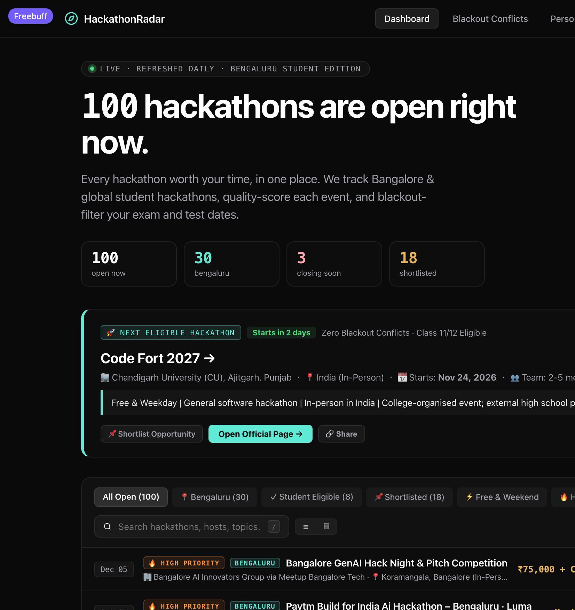
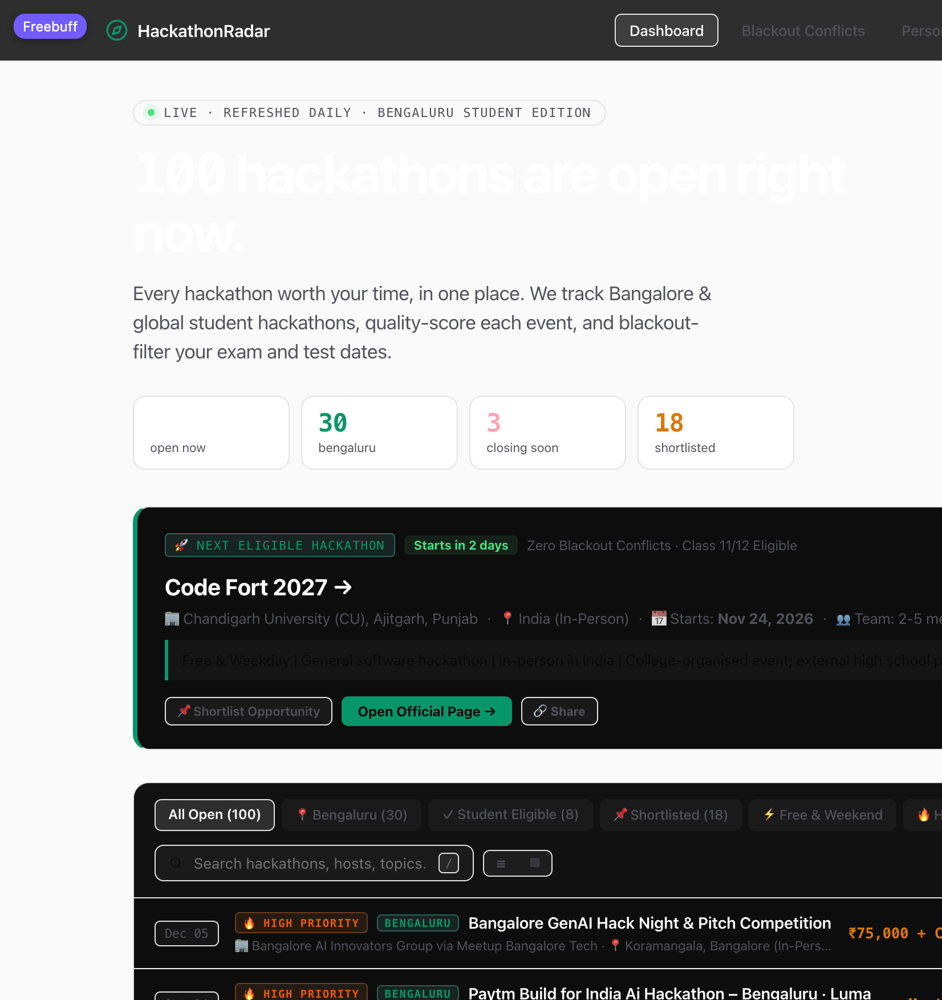
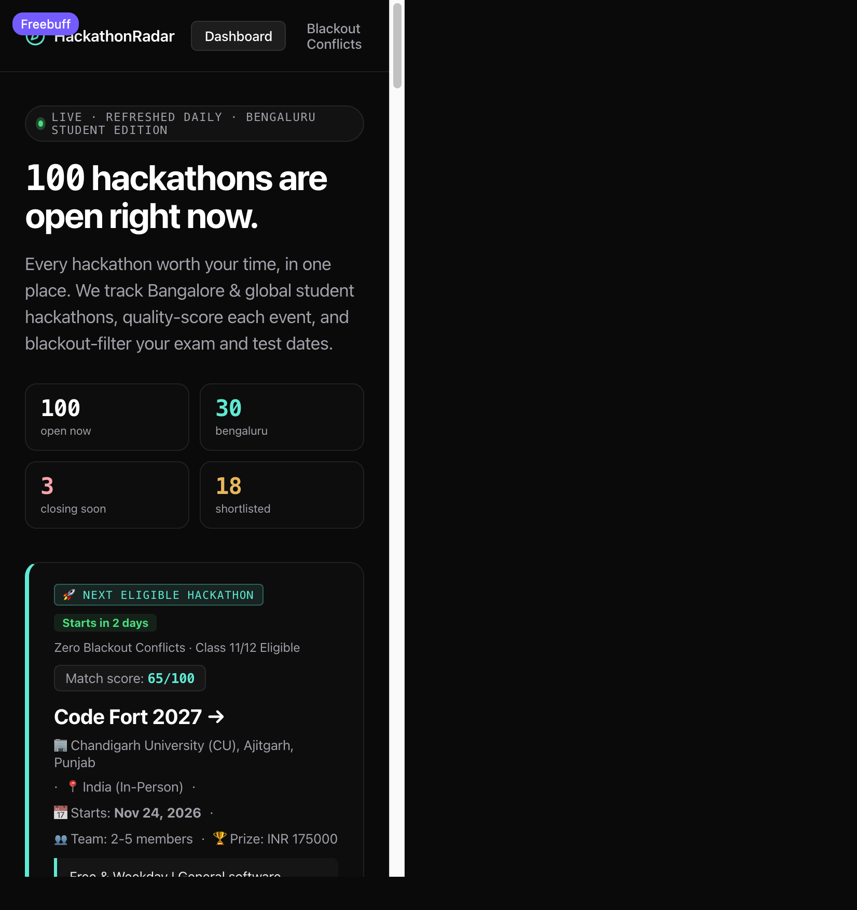
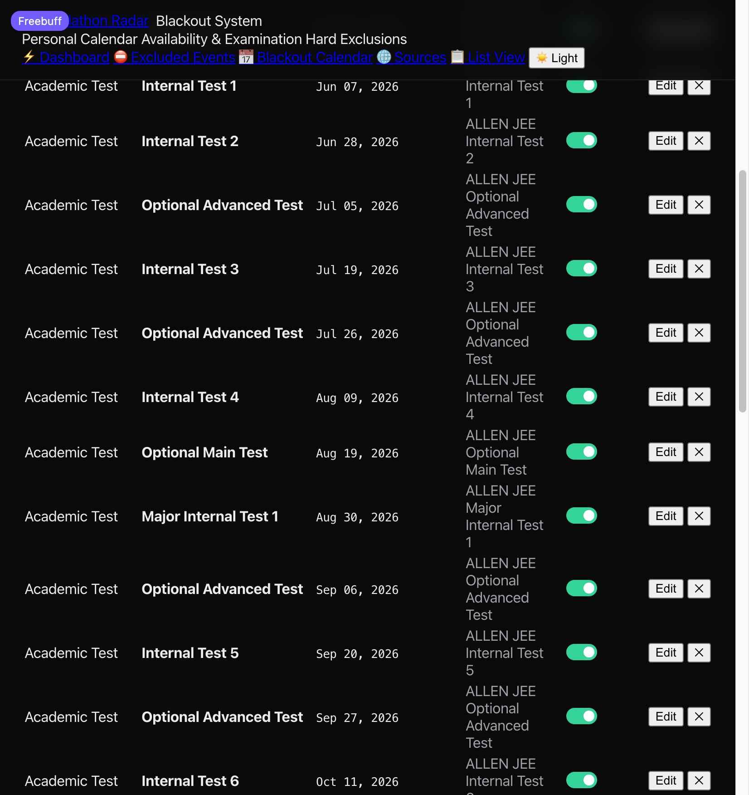
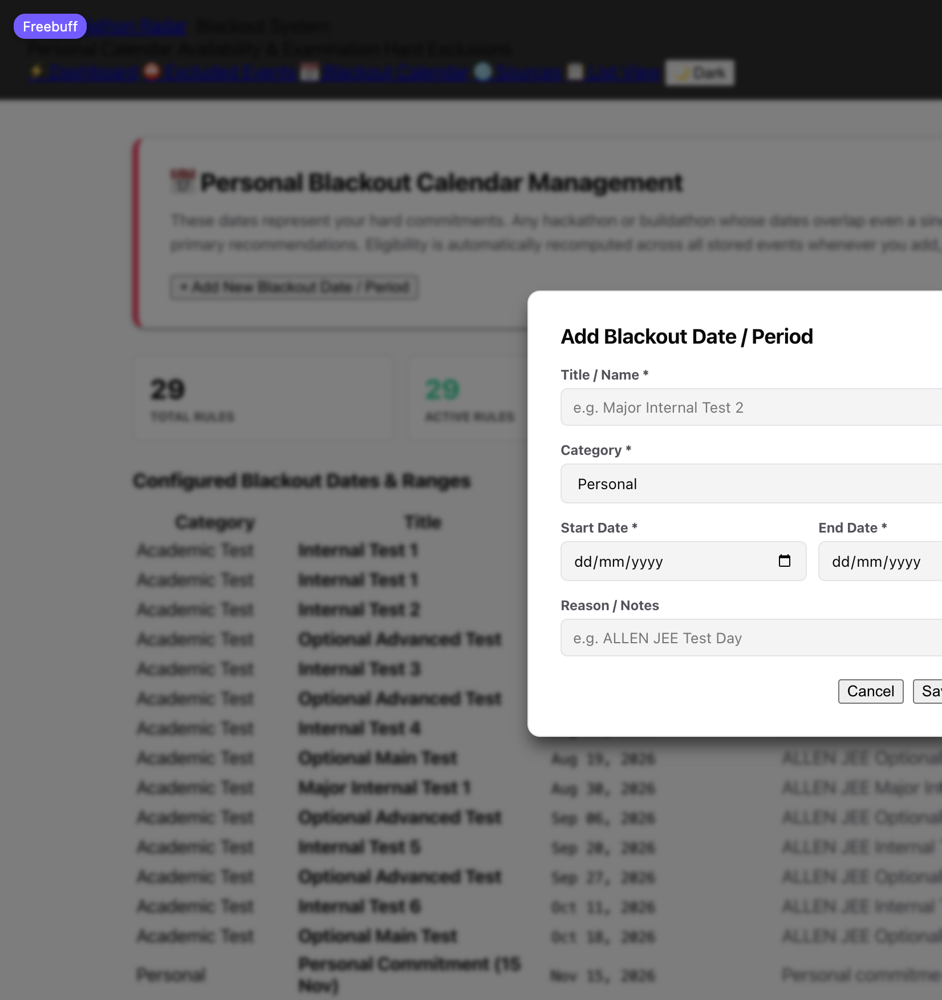
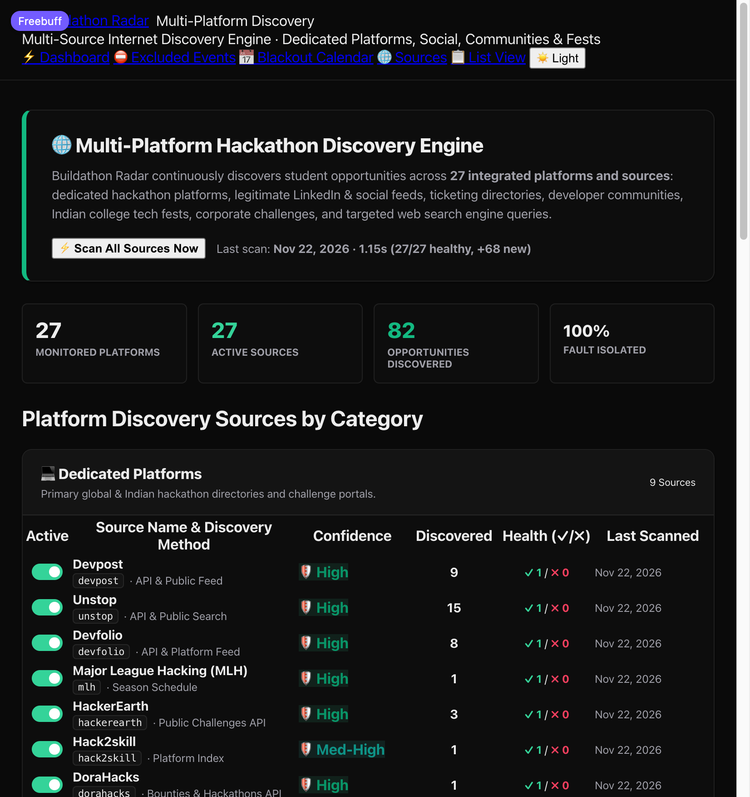
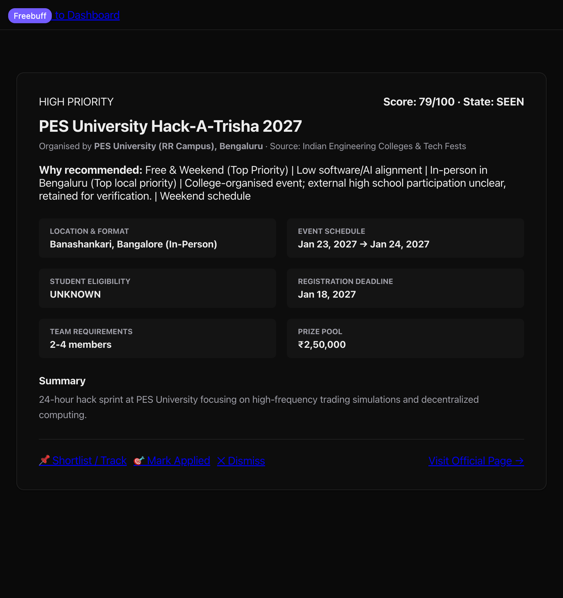

# Buildathon Radar — UX, Design Quality & AI-Slop Audit

**Date:** 2026-11-22
**Pages reviewed:** `/dashboard` (all filters), `/calendar`, `/sources`, `/list`, `/event/{id}`, 404, add-blackout modal.
**Viewports:** 1440×900 desktop, 390×844 mobile. Dark and light themes.
**Method:** real Chromium session, screenshots, DOM measurements, contrast computation, keyboard/accessible-name inspection.

---

## 1. Verdict

The **main dashboard does not look like a lazy AI-generated template**. It has a deliberate high-contrast dark theme, oversized editorial typography, monospaced numerals, restrained accents and a row-based list. That is above the usual gradient-card slop.

**But the product as a whole still reads as AI-generated**, for three reasons stronger than any visual effect:

1. **Fake data presented with total confidence** — "100 hackathons are open right now", "27/27 healthy", "100% FAULT ISOLATED", "verified" — while the list contains a 2014 policy hackathon and LinkedIn obituaries. Fake precision is the defining AI-slop signal here.
2. **Three unrelated design systems in one app.** Dashboard is styled; Calendar, Sources and Event Detail render default browser buttons and links with a broken header.
3. **The numbers contradict each other on the same screen** (100 vs 63, 30 vs 9, 3 vs 33), which no human designer would ship.

**Design quality score: 4/10.** Strong dashboard shell, broken system consistency, untrustworthy content.
**AI-slop score: 6/10** (1 = handcrafted, 10 = generic machine output). Restrained visuals, but synthetic content and metric theatre.

---

## 2. Screenshots

### Dashboard, dark (default)

### Dashboard, light

### Dashboard, mobile 390 px

### Calendar

### Add-blackout modal

### Sources

### Event detail

---

## 3. Findings

### U-01 — Calendar, Sources and Event Detail use a different, broken visual system

- **Severity:** High
- **Affected:** `/calendar`, `/sources`, `/event/{id}`; partially `/list`
- **Status:** Browser-verified
- **Description:** The header on these pages collapses into unstyled inline links (`⚡ Dashboard ⛔ Excluded Events 📅 Blackout Calendar 🌐 Sources 📋 List View`), buttons render as native OS controls (white "Edit", "✕", "Scan All Sources Now", "Cancel"), and the table overflows its container. Event Detail has no navigation at all, only a blue "← Back to Dashboard" link. The modal is clipped on the right so "Save Blackout Date" is partly off-screen.
- **Reproduction:**
  1. Open `/dashboard` — styled header with pill nav.
  2. Click "Personal Calendar" — header becomes plain text links; buttons become default grey/white.
  3. Open `/event/pes-aatmatrisha-hack-2027-01-23` — no nav, default blue action links.
  4. On `/calendar`, click "+ Add New Blackout Date / Period" — modal extends past the viewport edge.
- **Expected:** One design system, one header component, consistent button and table styles, modal constrained to viewport.
- **Actual:** Three visual languages; core controls look unfinished.
- **Evidence:** screenshots above; `_SHARED_HEAD_CSS` is included but does not define the header/nav/button classes those pages use.
- **Recommended correction:** Extract shared header, button, table and modal components; snapshot-test each page. This is the highest-leverage visual fix.
- **Confidence:** High

### U-02 — Light theme is unreadable

- **Severity:** High
- **Affected:** `/dashboard` (all pages using the theme toggle)
- **Status:** Browser-verified + measured
- **Description:** In light mode the H1 and the "100 open now" metric render white on `rgb(250,250,250)`. Measured contrast **1.04:1** (WCAG AA needs 4.5:1 for normal text, 3:1 for large). The "Next Eligible Hackathon" card stays dark while the page is light, producing a jarring block with dark text.
- **Reproduction:** click "☀️ Light" (or set `data-theme=light`).
- **Expected:** Complete light token set: dark heading, light cards, dark text, correct borders.
- **Actual:** White-on-white heading; mixed themes on one screen.
- **Evidence:** `audit-assets/dashboard-light.png`; computed colors: h1 `rgb(255,255,255)`, body `rgb(250,250,250)`, ratio 1.04.
- **Recommended correction:** Define semantic tokens for both themes and audit every component; add a contrast test in CI. Do not ship a theme toggle that produces unreadable pages.
- **Confidence:** High

### U-03 — Mobile navigation is clipped and the layout overflows

- **Severity:** High
- **Affected:** `/dashboard` at ≤768 px
- **Status:** Browser-verified + measured
- **Description:** At 390 px the header shows only "HackathonRadar", "Dashboard" and part of "Blackout Conflicts"; "Personal Calendar", "51 Sources", "Scan", "List View" and the theme toggle are off-screen. There is no hamburger or horizontal scroll affordance. `document.body.scrollWidth` is **758 px** for a **390 px** viewport.
- **Reproduction:** set viewport to 390×844; inspect header.
- **Expected:** Wrapping or collapsible nav, no horizontal overflow.
- **Actual:** Primary navigation inaccessible on a phone; content clipped.
- **Evidence:** `audit-assets/dashboard-mobile.png`; measured overflow and 6 header elements past the right edge.
- **Recommended correction:** Collapse nav into a menu below 768 px; make the filter row horizontally scrollable with snap; test at 360/390/768.
- **Confidence:** High

### U-04 — Metric theatre and fabricated certainty

- **Severity:** High
- **Affected:** `/dashboard`, `/sources`
- **Status:** Browser-verified
- **Description:** "100 hackathons are open right now", "27/27 healthy", "100% FAULT ISOLATED", "82 OPPORTUNITIES DISCOVERED" are presented as facts. The first is contradicted by the 63 rendered rows and 16 expired events; the second is contradicted by 19 fixture sources and a 403-ing Reddit adapter; "100% fault isolated" is not a meaningful metric.
- **Reproduction:** open `/sources`; compare with adapter probe and DB.
- **Expected:** Counts derived from the same query as the list; health labels that distinguish live/fixture/failed.
- **Actual:** Marketing copy masquerading as telemetry.
- **Evidence:** screenshots; functional findings F-01, F-10, F-11.
- **Recommended correction:** Remove "100% fault isolated". Replace with "4 live sources · 19 fixtures disabled · 1 blocked". Show "last successful fetch" per source.
- **Confidence:** High

### U-05 — The primary list contains stale news and non-events

- **Severity:** High
- **Affected:** Dashboard rows
- **Status:** Browser-verified
- **Description:** The first screen includes "Paytm Build for India Ai Hackathon – Bengaluru · Luma" (Oct 24, past), "A special moment from our journey…" (LinkedIn social post), "Hiring through hackathons is the new placement trend – The Times of India", "IIMB hosts Policy Hackathon 2014", and "Oakridge Codefest 2022". Several are labelled HIGH PRIORITY with scores 84–100.
- **Reproduction:** scroll the default dashboard.
- **Expected:** Only future, verifiable events; news separated or excluded.
- **Actual:** The list is unusable for discovery without manual filtering.
- **Evidence:** `audit-assets/dashboard-dark.png`; DB queries.
- **Recommended correction:** Fix F-01–F-04 before any visual polish. No redesign can compensate for bad data.
- **Confidence:** High

### U-06 — Search has no empty state

- **Severity:** Medium
- **Affected:** Dashboard search
- **Status:** Browser-verified
- **Description:** Typing "quantum" into the search box on the Bengaluru filter leaves a blank list with no message, no result count, and no way to clear except the `/` shortcut or Escape. The results counter element exists but is empty when there are zero matches.
- **Reproduction:** `/dashboard?filter=bengaluru` → type "quantum".
- **Expected:** "No events match 'quantum' in Bengaluru" + "Clear filters".
- **Actual:** Blank page.
- **Evidence:** DOM evaluation: 9 rows total, 0 visible, no empty-state text.
- **Recommended correction:** Add an empty state and a clear button; show the count.
- **Confidence:** High

### U-07 — Score explanation is a run-on string, not an explanation

- **Severity:** Medium
- **Affected:** Dashboard rows, `/event/{id}`, hero
- **Status:** Browser-verified
- **Description:** The detail page says: "Free & Weekend (Top Priority) | Low software/AI alignment | In-person in Bengaluru (Top local priority) | College-organised event; external high school participation unclear, retained for verification. | Weekend schedule". A student cannot see the 35/30/20/10/5 breakdown, cannot tell which factor dominated, and the same event is labeled HIGH PRIORITY at 79 despite "Low software/AI alignment".
- **Reproduction:** open `PES University Hack-A-Trisha 2027`.
- **Expected:** A score breakdown (Theme 5/35, Geography 30/30, Host 14/20, Format 10/10, Team 5/5, Timing 15) with short labels, plus a one-sentence rationale.
- **Actual:** Pipe-joined internal strings.
- **Evidence:** `audit-assets/event-detail.png`.
- **Recommended correction:** Persist and render component scores; cap lines and use chips; replace internal wording ("retained for verification") with student-facing copy.
- **Confidence:** High

### U-08 — Navigation and terminology are inconsistent

- **Severity:** Medium
- **Affected:** Global nav, dashboard pills
- **Status:** Browser-verified + code
- **Description:**
  - "51 Sources" in the dashboard nav but "27 Live Sources" in the health page and 27 adapters in code.
  - "Blackout Conflicts" (nav), "Personal Calendar" (nav), "Blackout Calendar" (calendar nav), "Excluded Events" (calendar nav) all point at overlapping concepts.
  - "Blackouts (53)" on the dashboard means conflicted *events*, while the calendar says 29 *rules* / 54 *days*.
  - "closing soon" shows 3 but renders 33.
- **Expected:** One name per concept; counts that match their destination.
- **Actual:** Four labels for the blackout feature; three different counts for sources.
- **Evidence:** snapshots and screenshots; `tracker_service.py` line 1513 and 314; JS line 1460.
- **Recommended correction:** Rename to "Sources (27)", "Calendar", "Excluded (53 events)"; remove the hardcoded 51.
- **Confidence:** High

### U-09 — Repetitive emoji iconography and mixed icon styles

- **Severity:** Low
- **Affected:** All pages
- **Status:** Browser-verified
- **Description:** Emoji are used as functional icons (📍 🏢 👥 📅 🏆 ⚡ 📌 🎯 🔗 ⛔ 🛰️ ☀️ 🌙) alongside text glyphs (✕, ☰, ▦, →). Rendering varies by platform, alignment is inconsistent, and the "Share" button uses 🔗 while list rows use a bare 🔗 button. The logo is an inline SVG with a circular mark that does not match the wordmark.
- **Expected:** One icon set (SVG, 16/20 px), consistent stroke and alignment; emoji only as decorative accents, never as the only affordance.
- **Actual:** Mixed emoji/text glyphs; inconsistent weight and baseline.
- **Evidence:** screenshots.
- **Recommended correction:** Adopt a small SVG icon set with `aria-hidden` and text labels.
- **Confidence:** High

### U-10 — Modal and table overflow

- **Severity:** Medium
- **Affected:** `/calendar` add/edit modal
- **Status:** Browser-verified
- **Description:** At 1440 px the modal's right edge is clipped; the primary "Save Blackout Date" button is partly off-screen. The underlying table also overflows horizontally, with "Reason & Description" wrapping every few words.
- **Reproduction:** `/calendar` → "+ Add New Blackout Date / Period".
- **Expected:** Modal max-width `min(500px, calc(100vw - 32px))`, centered, with internal scroll; table columns sized or stacked on narrow screens.
- **Actual:** Clipped primary action.
- **Evidence:** `audit-assets/calendar-add-modal.png`.
- **Recommended correction:** Use a dialog element with proper sizing and focus trap; make the table responsive.
- **Confidence:** High

### U-11 — Error/empty pages are off-brand

- **Severity:** Low
- **Affected:** `/event/{unknown}` (404)
- **Status:** Code-review + command
- **Description:** The 404 page is a minimal centered message using the shared CSS; it has no navigation back to the dashboard and no search.
- **Expected:** A consistent 404 with links to Dashboard and Sources.
- **Actual:** Dead end.
- **Evidence:** `/event/does-not-exist` returns 404 with `_unknown_event_page()`.
- **Recommended correction:** Add nav and recovery actions.
- **Confidence:** High

---

## 4. Accessibility findings

### A-01 — Light-mode contrast failure

- **Severity:** High
- **Affected:** `/dashboard` light theme
- **Status:** Measured
- **Detail:** H1 contrast **1.04:1**; "100" metric invisible. Fails WCAG 2.2 AA 1.4.3.
- **Correction:** Fix tokens; add automated contrast checks.

### A-02 — Icon-only controls have no accessible name

- **Severity:** Medium
- **Affected:** Dashboard rows, view toggles
- **Status:** Measured
- **Detail:** **125** `button` elements with 0–2 characters of text have `aria-label=null`, mostly the per-row "🔗" share button; also "☰" and "▦" view toggles. Screen readers announce "button" with no purpose.
- **Correction:** Add `aria-label="Copy registration link"`, `aria-label="List view"`, `aria-label="Grid view"`, `aria-pressed` states.

### A-03 — Mobile navigation inaccessible

- **Severity:** High
- **Affected:** 390 px viewport
- **Status:** Measured
- **Detail:** Six header controls extend past the viewport with no alternative. Keyboard users can tab to off-screen links without a visible focus target.
- **Correction:** Responsive menu; ensure focus is scrolled into view.

### A-04 — Tiny muted metadata

- **Severity:** Low
- **Affected:** Dashboard rows, calendar table
- **Status:** Visual
- **Detail:** 11 px uppercase labels and dense 12–13 px subtext; calendar "Reason" column wraps every 2–3 words. Hard to scan for a student on a laptop.
- **Correction:** Raise body text to 14–16 px; reduce metadata density; widen or stack the reason column.

### A-05 — No visible focus styling on custom controls

- **Severity:** Medium
- **Affected:** Filter pills, row actions, switches
- **Status:** Code/visual inspection
- **Detail:** Custom `<a>`/`
` pills and switch labels do not define `:focus-visible`; the calendar switch hides the native checkbox (`opacity: 0`).
- **Correction:** Add a consistent 2 px focus ring; keep the native control accessible.

### A-06 — Emoji read aloud

- **Severity:** Low
- **Affected:** All pages
- **Status:** Code review
- **Detail:** Emoji are not `aria-hidden`, so screen readers announce "pushpin", "trophy", "link" before every label.
- **Correction:** Wrap decorative emoji in ``.

**Not tested:** full screen-reader pass (VoiceOver/NVDA), keyboard-only end-to-end flow, zoom to 200%, reduced motion (there are few animations), and automated axe/Lighthouse audits.

---

## 5. Information hierarchy and visual design assessment

**What works**

- The dark palette is restrained: near-black canvas, one teal accent, one amber score accent. No gratuitous gradients or glassmorphism.
- The oversized headline is a strong editorial choice, and the row layout (date pill → title → metadata → score → actions) is easy to scan at desktop width.
- Monospaced dates and scores create a useful rhythm; the skip link and single H1 are correct.
- The "next eligible" spotlight is a good idea in principle.

**What undermines it**

- The hierarchy is built on a false premise: the biggest number on the page ("100") is wrong, and the spotlight is an out-of-city college event that the profile says should be excluded.
- Scores are visually prominent but semantically opaque; a 100 next to a news article destroys trust in the whole scale.
- The dashboard has no pagination or grouping. 63 events × ~6 lines each produce a 376 KB page and an undifferentiated wall; there is no "this week / next month" split despite the date data being available.
- Every row carries five emoji and four actions; the eye has no resting point. The share icon repeats 125 times.
- "Scout-like" branding ("HackathonRadar", 🛰️, "LIVE · REFRESHED DAILY") promises freshness the data does not deliver.
- The empty sections are not empty: they are padded with stale events, which is worse than an honest empty state.

**Recommendation:** Do not add more visual effects. Spend the next design pass on (a) removing false metrics, (b) one shared component system, (c) date grouping and a real empty state, (d) an honest data-status banner.

---

## 6. Usability walkthrough — student workflow results

| Step | Result | Note |
|---|---|---|
| 1. Open dashboard | OK | Loads in 40 ms |
| 2. Find relevant hackathons | **Fail** | List starts with expired/news items |
| 3. Search by keyword | Partial | Works only on rendered rows; blank state |
| 4. Apply location filter | **Fail** | "Bengaluru (30)" shows 9 and includes 8 past events |
| 5. Apply eligibility filter | Partial | Shows 8, but eligibility is self-certified |
| 6. Identify free events | **Unreliable** | `assess_cost` defaults to FREE when no fee text exists |
| 7. Identify weekend events | Partial | Filter exists; count label absent |
| 8. Open an event | OK | Detail page renders |
| 9. Inspect registration link | Mixed | Live events good; fixtures dead |
| 10. Understand score | **Fail** | Only a pipe-separated `why`, no breakdown |
| 11. Identify eligibility status | **Fail** | "HIGH PRIORITY" + "UNKNOWN" on same card |
| 12. Check exam conflicts | OK | Conflict flag and excluded filter work |
| 13. Navigate to calendar | OK link, broken page | Unstyled controls |
| 14. Manage a blackout rule | Partial | Modal clipped; CRUD works on DB copy |
| 15. Inspect source of an event | **Fail** | Only "via <source>"; no lineage UI |
| 16. Inspect scan logs | OK | One scan shown, but health is false |
| 17. Return to dashboard | OK | Header link present on calendar, absent on detail |

---

## 7. Priority fixes for design (after data integrity)

1. Fix light theme tokens and contrast (U-02/A-01).
2. Unify header/nav/buttons/tables across all pages (U-01/U-10).
3. Responsive navigation + no horizontal overflow (U-03/A-03).
4. Replace metric theatre with honest data-status counts (U-04).
5. Add search empty state and date grouping (U-06, hierarchy).
6. Score breakdown on detail + rows (U-07).
7. Accessible names and focus states (A-02/A-05).
